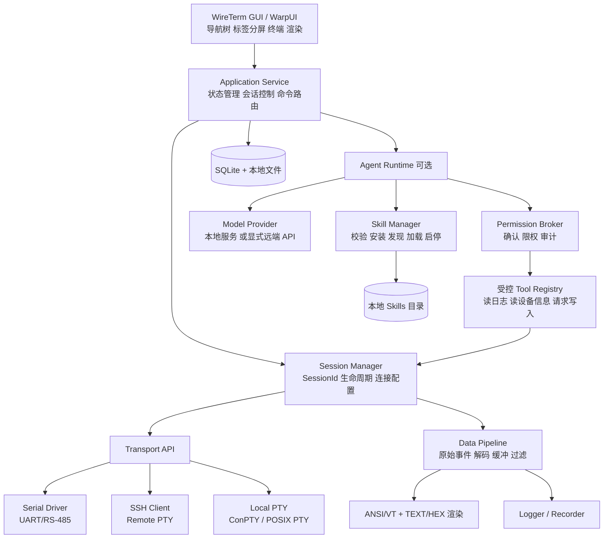
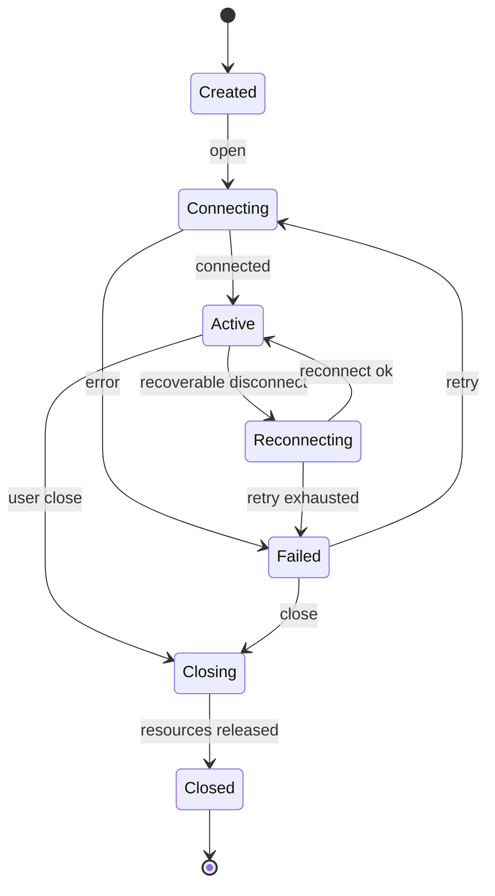
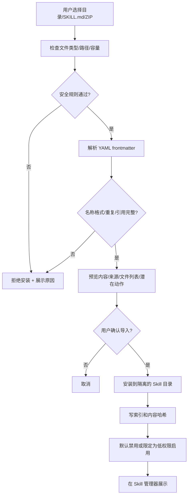
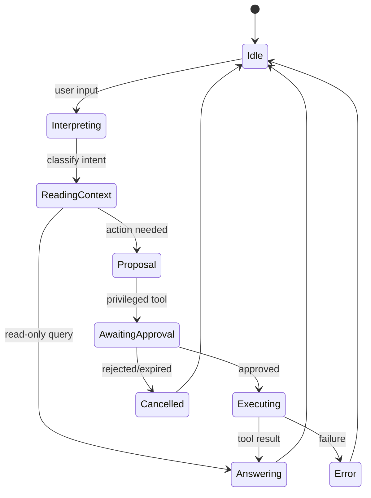

# WireTerm 系统详细设计方案 v1.0

> 项目名称：**WireTerm**  
> 产品定位：Professional Embedded Terminal / 专业嵌入式智能终端  
> 设计版本：v1.0  
> 基线日期：2026-11-07  
> 技术栈：Rust / WarpUI / Tokio / SQLite  
> 首发平台：Windows 10/11 x64（后续 Linux、macOS）  
> 产品原则：本地优先、串口为核心、SSH 与本地 Shell 并列、AI Agent 可选、Skill 手动导入、权限最小化

---

## 0. 设计状态、边界与术语

本文是**目标架构和迭代实施方案**，不是已实现功能说明。基于公开仓库文档作初步可行性设计；实际删改代码前必须锁定上游 commit、绘制真实依赖图并完成原版构建。

- **Warp**：上游开源终端客户端，Rust GUI 由 WarpUI 实现。
- **WireTerm**：Fork 后的新产品；不得保留会造成混淆的原品牌或未经许可的商标元素，须保留源码要求的版权/许可证声明。
- **Session**：一个串口、SSH 或本地 PTY 的逻辑会话。
- **Transport**：真正的数据读写通道，不含 UI、AI、渲染和业务格式化。
- **Skill**：采用 Agent Skills `SKILL.md` 规范打包的知识/流程；不等于代码插件，也不自动获得系统执行权限。
- **Tool**：Agent 可以请求调用的受控能力（读日志、读取设备信息、发送字节、执行 SSH 命令等）。
- **Agent**：WireTerm 新建的本地 Agent 编排和工具调用框架；不是 Warp 原有云端 Agent 的直接复用。

### 0.1 原项目已核实的事实

1. Warp 客户端主要使用 AGPL-3.0-only，部分 WarpUI 组件使用 MIT；Warp 服务端、Drive 后端、Oz 编排并不在仓库中。
2. 上游 `AGENTS.md` 描述 GUI 位于 `app/`，终端、workspace、auth、drive、settings、ai 等属于应用区域；复用候选 crate 有 `warp_terminal`、`warpui`、`warpui_core`、`warp_core` 等。
3. 上游有 `.agents/skills/` 和 `skills-lock.json`，用于**仓库开发辅助**；不等于应用内对最终用户提供的 Skill 安装、信任、运行与管理机制。
4. Warp 客户端已含相当规模的 Agent 基建：`crates/ai`（`agent/`、`llm_provider`、`skills/`）、`crates/mcp`（tool-call 运行时）、`crates/computer_use`、`warp_multi_agent_client`；模型执行的云端 harness/编排后端仍在服务端。WireTerm 独立运行 Agent 不是从零重写，而是复用/裁剪客户端编排与工具层，替换模型提供者与云端依赖。
5. 上游默认二进制是 `warp-oss`（`app/Cargo.toml` 的 `default-run`），其 `Channel::Oss` 已禁用遥测/崩溃上报/自动更新，但仍配置 `WarpServerConfig::production()` 与 `OzConfig::production()`，不能仅靠切到 warp-oss 就实现彻底去云。
6. 上游 SSH 以 `app/src/remote_server/ssh_transport.rs` 实现：通过 SSH ControlMaster 安装并启动远端 `remote-server-proxy`，属于「Warp 远程服务器 over SSH」，不是 russh 式直接远程 PTY。
7. 客户端已有 `SKILL.md` 解析/Skill 提供者（`crates/ai/src/skills/`）；持久化层用 Diesel（`crates/persistence`），非 sqlx；另有现成 CLI crate `crates/warp_cli`。

官方参考：
- https://github.com/warpdotdev/warp
- https://github.com/warpdotdev/warp/blob/master/AGENTS.md
- https://github.com/warpdotdev/warp/blob/master/FAQ.md
- https://github.com/warpdotdev/warp/blob/master/Cargo.toml
- https://agentskills.io/specification

---

## 1. 产品目标与非目标

### 1.1 主要目标

1. **串口专业化**：COM/tty 端口发现、波特率/数据位/校验/停止位、流控、DTR/RTS、收发、HEX/TEXT、编码、自动保存日志、断连提醒、设备重连。
2. **SSH 与 PTY**：安全远程 shell、本地 PowerShell/CMD/其他 shell、ANSI/VT 终端、标签页及分屏。
3. **强工程属性**：多设备、命令模板、快捷发送、时间戳、搜索、过滤、收发计数、操作审计、会话恢复。
4. **无 Warp 云依赖**：不要求账号登录；终端的基础能力不依赖 DNS/互联网；配置和历史默认在本地。
5. **可选择的 AI**：AI 不影响串口基本能力。模型可用本地推理服务或用户自配的远端兼容接口，只有用户明确配置后才发起网络模型请求。
6. **手动加载 Skill**：支持本地文件夹、`SKILL.md`（单文件导入受限）、ZIP 包；安装前验证、预览、权限审查、显式启用、可卸载，按需渐进加载。

### 1.2 暂不做的事项

- 不实现 Warp 账号、Warp Drive 云同步、Oz 任务编排、订阅/配额/团队协作。
- 不承诺兼容所有 Warp 内部插件接口或继续完全同步 Warp 所有上游更新。
- v0.1 不做 AI 自动控制真实设备或自由执行 Skill 自带脚本。
- v0.1 不做设备固件刷写、JTAG/SWD 调试或通用协议分析仪；它们可作为未来有隔离权限的扩展。
- 不把 RS-485 误认为单独的软件数据协议：上层串口参数仍依赖具体转换器和设备，半双工方向控制须按硬件能力设计。

### 1.3 版本范围

| 版本 | 里程碑 | 交付范围 |
|---|---|---|
| v0.1 (MVP) | 独立离线终端 | 原版编译基线；云依赖隔离；本地 PTY、SSH、Serial；文本与 HEX；日志；配置；Skill 本地导入/浏览/启停；**不执行 Skill 脚本** |
| v0.2 | 本地 Agent | 模型连接器；只读分析；手动/按需 Skill 注入；受控工具系统；权限确认与审计 |
| v0.3 | 工程增强 | 日志解析规则、自动命令模板、设备档案、会话导出、Agent 可控设备动作、SFTP（评估后） |
| v1.0 | 稳定发布 | 跨平台、回归测试与升级策略、安装包/签名、安全审计、文档完善 |

---

## 2. 系统总体架构



**单向边界约束**：Transport 不感知 UI、Agent、Skill；Skill 不直接持有串口文件句柄；Agent 不得绕过 Permission Broker 调用 Transport；UI 不参与阻塞 IO。

### 2.1 分层职责

1. `ui`：显示、交互、布局、快捷键、状态提示。
2. `application`：将 UI 意图转成命令，编排 Session、配置、日志、Agent。
3. `domain`：会话、设备、配置、事件、权限等稳定业务类型。
4. `transport`：Serial/SSH/PTY 的打开、关闭、read/write、resize/参数变更。
5. `pipeline`：字节、文本、HEX、ANSI、日志、过滤、计数。
6. `skill`：Skill 包加载、验证、元数据索引、按需上下文读取。
7. `agent`：模型连接器、上下文组装、工具调用状态机、审计。
8. `infra`：SQLite、文件系统、安全存储、异步任务、诊断日志。

---

## 3. 建议源码工程结构

以下为**目标目录**，不是现有 Warp 仓库真实目录。优先增量加入新的 `wireterm_*` crate，在迁移稳定后再重命名、删除原模块。

```text
wireterm/
├── app/                           # 从 Warp app 演化而来，保留可用 UI/terminal/workspace
│   └── src/
│       ├── wireterm_app/          # 独立启动 / 生命周期 / 路由
│       ├── views/
│       │   ├── workspace/
│       │   ├── serial_console/
│       │   ├── ssh_console/
│       │   ├── device_manager/
│       │   ├── skill_manager/
│       │   ├── agent_panel/
│       │   └── settings/
│       └── ...                    # 上游剩余模块：依赖核查后逐步处理
├── crates/
│   ├── warp_terminal/             # 上游终端能力，评估依赖后保留
│   ├── warpui/                    # 上游 UI，遵照 MIT 许可
│   ├── warpui_core/
│   ├── wireterm_core/             # 领域模型/会话接口
│   ├── wireterm_transport/        # Transport trait + 事件
│   ├── wireterm_serial/           # tokio-serial/serialport 适配
│   ├── wireterm_ssh/              # SSH client 适配
│   ├── wireterm_pty/              # 本地 PTY 适配
│   ├── wireterm_pipeline/         # 数据分发/解码/缓冲/过滤
│   ├── wireterm_recorder/         # 原始日志与文本日志
│   ├── wireterm_storage/          # SQLite/文件/配置
│   ├── wireterm_skills/           # Skill 加载器/验证/注册
│   ├── wireterm_agent/            # Agent Runtime/模型/工具
│   ├── wireterm_security/         # 权限/路径校验/凭据
│   └── wireterm_integration_tests/
├── examples/
│   └── skills/
│       └── uart-log-triage/
│           ├── SKILL.md
│           └── references/
├── docs/
│   ├── architecture/
│   ├── decisions/                 # ADR：架构决策记录
│   ├── protocols/
│   └── user-guide/
├── scripts/
├── .github/workflows/
├── LICENSE-AGPL
├── LICENSE-MIT
├── THIRD_PARTY_NOTICES.md
└── Cargo.toml
```

### 3.1 命名规则

- Crate：`wireterm_<module>`，目录与 crate 命名一致。
- Rust 类型：`SessionManager`, `SerialProfile`, `SkillManifest`, `PermissionDecision`。
- 前端视图：`SerialConsoleView`, `SkillsManagerView`。
- 统一对象 ID：UUID 或稳定不重复的内部 ID，不拿 COM 名称做 Session 唯一键。
- 上游 `warp_*` crate 在代码没有迁移完成前不强制一次性重命名，避免破坏 Cargo 工作区引用。

---

## 4. Warp 源码复用与云服务裁剪

### 4.1 裁剪矩阵

| 上游候选区域 | 初步决策 | 具体措施 | 退出条件 |
|---|---|---|---|
| `app/terminal/`, `crates/warp_terminal/` | 优先保留 | 路由/渲染/终端解析解耦，接入 Session 层 | 串口与 PTY 使用同一工作区展示 |
| `app/workspace/` | 选择性保留 | 标签页、分屏、会话布局 | 完全本地可恢复工作区 |
| `app/settings/` | 重构 | Warp 服务端配置替换本地配置 | 无登录可保存/读取 |
| `app/auth/` | 移除业务 | 先隔离调用、默认本地身份 | 离线正常启动 |
| `app/drive/` | 移除业务 | 去除菜单/同步任务/启动副作用 | 无云同步请求 |
| `app/ai/` | 重建/替换 | 客户端已有 `crates/ai`(agent/llm_provider/skills)、`crates/mcp`(tool-call 运行时)、`warp_multi_agent_client`；裁剪云端 harness 与模型后端，复用编排/工具/技能解析层 | 关闭 Agent 时无外部调用 |
| 云服务器、GraphQL 相关 crates | 候选移除 | 对依赖图逐 crate 收缩 | 无悬挂依赖和编译错误 |
| WarpUI | 继续复用 | 修改品牌和工作区视图 | GUI 正常渲染 |
| 上游 `.agents/skills` | 开发用保留/另行维护 | 不作为用户运行时 Skills | 开发和产品目录隔离 |

> **禁止直接删除目录**：先使用 `cargo metadata`、`cargo tree` 和代码搜索查清引用、初始化顺序、后台任务与特性开关；应采用逐切片替换/裁剪。

### 4.2 实施步骤

**阶段 A：原始基线**

- 克隆 Warp，记录 `git rev-parse HEAD`、Rust toolchain、平台、依赖版本。
- Windows 建好 MSVC Build Tools + Windows SDK + Rust MSVC 环境。
- 完成原版 `cargo check -p warp`、启动、一次 PTY/SSH 会话、退出验证。
- 在 `docs/decisions/` 记录构建问题与修复；不要在基线阶段重命名或删模块。

**阶段 B：切断云功能的可见入口**

- 将云登录、Drive、团队、订阅、远程 Agent 的 UI 入口置为构建期禁用或本地功能门控。
- 替换启动过程中账号检查、订阅加载、远程配置拉取、遥测等触发点。
- 用本地状态提供必要默认值；断网启动验证。

**阶段 C：解除依赖与删除代码**

- 按调用链逐步替换依赖，之后从 Cargo manifest 删除不再引用的依赖。
- 检查 license、图标、隐私提示、崩溃上报、更新检查、analytics、自动下载功能；不得仅通过 UI 隐藏视为云服务已移除。
- 每次变更都验证 `cargo check`、关键 UI smoke test、离线流量测试。

**阶段 D：产品独立化**

- 名称/窗口/进程/图标/安装路径/配置目录从 Warp 迁移为 WireTerm。
- 使用 WireTerm 自己的升级、版本发布、隐私策略；首发关闭自动更新，后续更新检查由用户选择启用。
-保留上游版权、许可及第三方 Notice，不将现有商标资源误用为新的品牌资产。

### 4.3 推荐调查命令

```bash
# 原版 clone 后在仓库根目录执行
git rev-parse HEAD
cargo metadata --no-deps --format-version 1 > cargo-metadata.json
cargo tree -p warp --depth 2
rg -n 'auth|drive|telemetry|graphql|server_client|server_auth|analytics|sentry' app crates
rg -n 'agent|skill|completion|workspace|terminal' app crates
cargo check -p warp
```

这些命令只是调查起点。`cargo tree` 中的真实 package 名称及环境构建命令，以锁定版本为准。

---

## 5. 统一终端会话模型

### 5.1 会话状态机



必须区分 `Disconnected` 与 `Closed`；用户手动关闭后不得被自动重连逻辑意外重新打开。

### 5.2 统一核心类型（伪代码）

```rust
// 接口草案：用于讨论边界，并非对当前 Warp 可直接编译的补丁。
#[derive(Clone, Copy, Debug, Eq, PartialEq, Hash)]
pub struct SessionId(pub uuid::Uuid);

pub enum TransportKind { Serial, Ssh, LocalPty }
pub enum SessionState { Created, Connecting, Active, Reconnecting, Failed, Closing, Closed }

pub enum SessionEvent {
    StateChanged { session: SessionId, state: SessionState },
    Received { session: SessionId, at_ms: u64, bytes: bytes::Bytes },
    Sent { session: SessionId, at_ms: u64, bytes: bytes::Bytes },
    Resized { session: SessionId, cols: u16, rows: u16 },
    Error { session: SessionId, message: String },
}

#[async_trait::async_trait]
pub trait Transport: Send + Sync {
    async fn open(&mut self) -> anyhow::Result<()>;
    async fn write(&mut self, data: bytes::Bytes) -> anyhow::Result<usize>;
    async fn close(&mut self) -> anyhow::Result<()>;
    // 数据由 read task 产生并通过统一事件通道输出；不要让 UI 同步 read。
}
```

接口落地时按库特性明确 task owner、IO 的借用/独占、取消策略、shutdown 时序；不要把 `write` 和 `read` 的锁耦合成单个长时间占用的互斥锁。

### 5.3 数据通路与并发

```text
Device / SSH / PTY
   │ raw bytes
   ▼
IO task（持有真实句柄）
   ├── bounded channel -> Recorder（保证完整原始数据）
   ├── bounded channel -> Decoder/Filter -> bounded UI coalescer -> renderer
   └── bounded event bus -> Agent read-only context (按权限/采样读取)

UI input -> Application command -> bounded write queue -> Transport writer
```

- 统一用 Tokio 异步任务承担连接；界面线程只收取短批次状态/绘制事件。
- 任务取消：`CancellationToken` 取消读写任务，收到 join 完成后释放端口。
- 有界 channel：每个消费者独立队列，避免 AI/日志/渲染相互阻塞。
- **完整性优先**：日志数据不能因 UI 跟不上而无声丢失；设置 spool/磁盘配额策略；超限必须可见地停止录制/报告错误，不可假称完整。
- 显示可降采样：过载时合并绘制批次，标记跳过多少显示内容，仍允许打开原始日志检查。
- 性能建议值（待实测调整）：UI 30–60 FPS，绘制批量节流 16–33 ms；每会话 10–50 MB 内存环形缓存作为可配置范围；至少测试 100 KB/s~1 MB/s 持续串口输入压力。
- 数据 `Received` 不等于有意义的命令结果；只有具备 Shell/协议解析器时才能做命令块识别。

---

## 6. 串口模块设计

### 6.1 硬件与平台

- Windows：`COM1`、`COM10` 等设备；Linux：`/dev/ttyUSB*`, `/dev/ttyACM*`；macOS：`/dev/cu.*`。
- 支持 USB 转 UART、带有对应驱动的 USB 转 RS-485、物理串口。
- 默认不开启未经用户确认的 DTR/RTS 自动翻转；某些板卡会因控制线变化复位/进入引导模式。
- 只对支持的适配器声明自动方向控制；RS-485 半双工/RTS 手动控制是硬件相关特性。

### 6.2 SerialProfile 字段

| 字段 | 说明 | 默认建议 |
|---|---|---|
| `device_id` | 稳定的设备档案 ID | UUID |
| `port` | 当前设备路径 | 用户选择 |
| `vid/pid/serial_number` | 可用时作为 USB 身份指纹 | 可选 |
| `baud_rate` | 波特率 | 115200 |
| `data_bits` | 数据位 | 8 |
| `parity` | 校验 | None |
| `stop_bits` | 停止位 | 1 |
| `flow_control` | 流控 | None |
| `dtr/rts` | 控制线目标状态 | 用户配置，避免无意切换 |
| `encoding` | 文字解码 | UTF-8，支持 GBK/GB2312 等 |
| `send_mode` | TEXT / HEX | TEXT |
| `line_ending` | LF / CRLF / CR / None | 可配置 |
| `reconnect` | 是否自动重连 | 默认关闭、用户开启 |
| `logging` | 录制策略 | 开启/关闭可选 |

### 6.3 串口接收路径

1. 枚举系统端口，展示友好名称 + 路径 + VID/PID/序列号（可用时）。
2. 选定设备档案、校验端口是否被占用。
3. 连接成功后生成 `session_id` 并启动非阻塞读任务。
4. 读取原始 bytes，生成带时间戳、方向、session_id 的事件。
5. Recorder 存原始数据；Decoder 进行增量解码，正确处理 UTF-8/GBK 跨包字符。
6. 文本视图展示行时间戳、关键字着色；HEX 视图展示 offset / hex / ASCII。
7. 可选择 ANSI/VT 模式（对串口 Linux shell）；普通 MCU 原始串口默认文本/HEX 模式，不推断提示符。

### 6.4 发送路径

- 支持 ASCII/UTF-8/GBK 等编码、HEX 发送、快捷命令模板、CRLF 配置、发送历史。
- 发送前检查 SessionState 和数据合法性；HEX 输入应验证偶数字符和合法十六进制格式。
- 同一 Session 的写操作按队列严格排序；记录发送请求、实际写入长度与错误。
- 可增加定时发送，但**只能在会话打开且用户启用时工作**；关闭/断连自动取消。
- 警告：RTS/DTR、Break、重复发送、字节注入可能改变硬件状态，应有明确控件与禁用条件。

### 6.5 重连策略

- 仅当用户开启自动重连且连接不是手动关闭时尝试。
- 以设备指纹优先匹配；不允许仅按“新出现的任意 COM 口”静默重连，避免误连另一块板卡。
- 指数退避，例如 1s→2s→4s→8s（上限 30s）；网络/驱动断开可触发重新扫描。
- 重连成功应生成事件并记录时间，不自动重放用户上次发送的命令。

### 6.6 推荐 crate

- `tokio-serial`：Rust + Tokio 的异步串口实现；用于打开/异步读写。
- `serialport`：设备列表与同步接口，作为适配层的候选工具。
- `encoding_rs`：增量字符集解码（具体可用编码需核实并做兼容测试）。

参考：https://docs.rs/tokio-serial/latest/tokio_serial/

---

## 7. SSH 与本地终端设计

### 7.1 SSH

- **现状**：上游 SSH 已存在但形态不同——`app/src/remote_server/ssh_transport.rs` 通过 SSH ControlMaster 安装并启动远端 `remote-server-proxy`，其 stdin/stdout 作为协议通道，属于「Warp 远程服务器 over SSH」，而非直接打开远端 shell PTY；另有 `app/src/terminal/ssh/`、`app/src/settings/ssh.rs`、SSH 文件上传等界面。复用前必须评估该路径对 `remote_server`/代理二进制的耦合是否可接受。
- 若目标是「SSH 与本地 Shell 并列的普通远程终端」，现有 remote-server 架构并不等价，可能需新做直接远程 PTY 客户端（候选 `russh`）；若保留 Warp 远程服务器体验，则评估复用 `ssh_transport` 并继续裁剪其云/代理依赖。
- 无论采用哪条路径，都要满足：握手、主机密钥验证、用户认证、请求远端 PTY、交互 shell、窗口大小变化、退出与重连。
- 用户名、Host、Port、Profile 独立保存；密码、密钥口令通过 OS 安全存储管理，不将明文写 SQLite/日志。
- 初次连接弹出 Host Key 指纹确认；已知 Host Key 变化必须高优先级拦截，绝不能自动接受。
- 支持认证失败/超时/网络断开错误区分、keepalive、退避重连、会话工作目录等概念。
- v0.1 必须区分 SSH 交互命令流与 `exec` 工具调用；AI 请求执行命令走权限控制。

参考：https://docs.rs/russh/latest/russh/

### 7.2 本地 PTY

- Windows 使用 ConPTY，macOS/Linux 使用 PTY。
- 用户可以选择 PowerShell、cmd 或自配置的可执行 Shell。
- 终端 Escape Sequence 由现有 Warp 终端渲染处理；不要自造一个与 WarpUI 不兼容的文字框。
- 原样保留 Ctrl+C、Ctrl+Z 等键盘控制行为，Clipboard 与输入法行为需系统测试。

### 7.3 模式差异

| 维度 | 串口 MCU | 串口 Linux Console | SSH | 本地 PTY |
|---|---|---|---|---|
| 可视为字节流 | 是 | 是 | 是 | 是 |
| 一定有 Shell | 否 | 不一定 | 通常有（交互模式） | 有 |
| ANSI 终端仿真 | 可选 | 通常需要 | 需要 | 需要 |
| 命令退出码 | 通常没有 | 需要协议/封装 | exec 模式可获得 | 可获得 |
| AI 自动执行 | 默认禁止 | 需授权 | 需授权 | 需授权 |

---

## 8. UI/UX 设计

### 8.1 工作区布局

```text
┌──────────────────────────────────────────────────────────────────────────┐
│ WireTerm   [设备] [会话] [Skill] [工具] [设置]      状态 / 搜索 / 帮助  │
├───────────────┬────────────────────────────────────────┬─────────────────┤
│ 连接/设备树    │ [COM7] [SSH:192.168.x.x] [PowerShell] │ Agent / Skills  │
│               ├────────────────────────────────────────┤                 │
│ + 新建连接     │                                        │ [聊天] [技能]    │
│ ● COM7 115200 │       串口终端 / 终端仿真区域          │                 │
│ ● SSH Server  │       支持标签、分屏、滚动、查找       │ Skill 列表      │
│ ○ 本地 Shell  │                                        │ 手动加载       │
│               ├────────────────────────────────────────┤ 权限状态        │
│ 设备分组       │ [TEXT] [HEX] [编码] [发送] [命令模板]  │ 执行预览        │
├───────────────┴────────────────────────────────────────┴─────────────────┤
│ 状态栏：连接时间 / 收发字节 / COM 参数 / 日志 / 告警 / Skill 已启用数量│
└──────────────────────────────────────────────────────────────────────────┘
```

### 8.2 UI 组件

- `ConnectionNavigator`：设备树、分组、搜索、状态灯。
- `WorkspaceTabs`：标签页、拖放、分屏、最近连接。
- `TerminalSurface`：兼容 Warp 原终端 UI 的显示与交互。
- `SerialToolbar`：COM 选择、波特率、参数设置、连接状态、HEX/TEXT。
- `SendComposer`：多行输入、模板、周期发送（可选）、历史。
- `LogPanel`：过滤器、关键字、时间范围、原始日志路径、导出。
- `AgentPanel`：分析、建议、操作计划、人工确认。
- `SkillManagerView`：导入、校验、预览、启停、权限、冲突、版本、删除。
- `AppStatusBar`：IO 速率、会话数、日志写入状态、Agent/模型在线情况。

### 8.3 交互原则

- 新开串口：默认仅收听，**不自动发送数据**。
- 未连接时，“发送”按钮禁用；断线可恢复编辑草稿但不自动发送历史内容。
- 左侧设备树和右侧 Agent 抽屉均可隐藏，不挤占串口监控主视图。
- Agent 输出需要明确区分“分析建议”“拟执行操作”“已执行结果”。
- 一句自然语言（如“列出当前目录”）只对应其明确请求，不自动扩大为磁盘扫描或环境诊断。

---

## 9. 本地存储与日志

### 9.1 持久化拆分

**SQLite（结构化轻量数据）**：设备档案、连接参数、工作区、会话索引、Skill 注册信息、启停状态、授权记录、命令模板、审计事件。  
**文件（大对象/日志）**：原始二进制日志 `.bin`、带方向/时间戳的 `.jsonl`、可读 `.log`、Skill 文件夹、导出包。

Windows 推荐使用操作系统应用数据路径（通过 `directories` 等库解析），例如 `%APPDATA%/WireTerm`；缓存及大日志可按 Local AppData 单独组织，不硬编码用户账户目录。

```text
WireTermData/
├── config/settings.toml
├── database/wireterm.db
├── profiles/
├── skills/
│   └── uart-log-triage/
├── sessions/YYYY-MM-DD/<session-id>/
│   ├── raw.bin
│   ├── events.jsonl
│   └── summary.json
├── exports/
├── cache/
└── diagnostics/
```

### 9.2 SQLite 概念模型

```text
device_profiles(id, label, transport_kind, fingerprint, config_json, updated_at)
workspaces(id, name, layout_json, updated_at)
sessions(id, profile_id, started_at, ended_at, outcome, log_path)
skills(id, name, description, version, source_type, install_path,
       content_hash, enabled, trust_level, installed_at)
skill_scopes(skill_id, scope_type, scope_id, enabled)
permission_grants(id, subject_kind, subject_id, tool_id, scope, expires_at)
audit_events(id, occurred_at, actor, action, target, outcome, metadata_json)
command_templates(id, title, transport_kind, content, terminator, updated_at)
```

- 密码/API Key 不在 SQLite 以明文保存；仅存 SecretRef，值进 Windows Credential Manager 等安全存储。
- DB 沿用上游 `crates/persistence` 的 Diesel ORM + `diesel_migrations`（当前仓库已用 Diesel，不是 sqlx）；崩溃恢复测试包括 WAL 与日志轮转中断。
- 默认限制会话历史保存期限和磁盘配额；提供日志敏感信息遮蔽与清除功能。
- 导出日志时让用户预览是否包含 IP、账号、token、设备序列号等信息。

---

## 10. Skill 系统 —— 核心新增功能

### 10.1 目标

用户可以**手动加载自己的 Skill**，即把一个标准 `SKILL.md` 的文件夹拖入 WireTerm，就能在 Skill 管理器中看到、预览、启用，并在相应工作区/设备下供 Agent 使用。

**必须明确：加载 Skill ≠ 立刻运行脚本 ≠ 默认允许访问串口/SSH。** Skill 是能力描述和流程知识。工具执行始终由 WireTerm 工具权限系统管控。

**现状**：上游 `crates/ai/src/skills/` 已有 `SKILL.md` 解析（frontmatter `name`/`description`）、SkillProvider/Scope、读取与引用解析（`parse_skill`、`read_skills`、`skill_reference`、`listed_skill`）。WireTerm 的 Skill 管理器应优先复用这套解析/读取能力，把工作重心放在「本地导入入口、隔离安装、启停/卸载、权限审批」等上游缺失的产品层能力，而不是重新实现 frontmatter 解析。

### 10.2 支持格式与优先级

| 导入方式 | v0.1 | 行为 |
|---|---|---|
| 选择本地 Skill 文件夹 | 是 | 查找根目录 `SKILL.md`，连同 references/assets/scripts 复制到私有目录 |
| 单独选择 `SKILL.md` | 是 | 仅导入该文件为单文件 Skill；引用到的资源标记缺失/要求补全 |
| 拖入 ZIP | 是 | 安全解压、检查包内顶层 Skill 目录、验证后导入 |
| 选择 ZIP 内的多个 Skill | 可选 | 优先 v0.2，或先只接受一个顶层 Skill |
| 输入 Git 仓库 URL | v0.2+ | 需要网络来源、版本锁定和额外供应链审计 |
| 在线 Skill 市场 | 暂不做 | 避免引入新云平台与账号要求 |

### 10.3 兼容 Agent Skills 规范

标准 Skill 目录：

```text
uart-log-triage/
├── SKILL.md
├── references/
│   └── log-patterns.md
├── scripts/        # 可包含脚本，但 v0.1 禁止自动执行
└── assets/
```

`SKILL.md` 规范示例：

```markdown
---
name: uart-log-triage
description: Analyze UART and embedded Linux boot logs, identify errors, and recommend next diagnostic steps. Use for MCU boot failures, kernel panics, and serial console debugging.
metadata:
  author: wireterm-community
  version: "0.1.0"
---

# UART Log Triage

## Workflow
1. Confirm target session and time range.
2. Read only the log excerpt authorized by the user.
3. Separate observed facts from hypotheses.
4. Summarize key errors, evidence and recommended next checks.
5. Do not send commands or modify device state without explicit permission.

See [log patterns](references/log-patterns.md).
```

依据 https://agentskills.io/specification ： `name`、`description` 是必须字段；`metadata` 可选。示例中的 `metadata.version` 是产品自定义版本约定，不代表 Agent Skills 强制规定语义版本。官方还支持 `license`、`compatibility` 和实验性的 `allowed-tools`；任何 `allowed-tools` 仅作请求/提示，不能替代 WireTerm 的权限审批。

### 10.4 Skill 安装流程



**推荐默认**：新导入 Skill 完成后处于“已安装、未启用”，由用户点击启用；开启后进入候选 Skill 列表，但不会自动运行它的脚本。对可信官方内置 Skill 可由产品明确列出例外，第三方仍应默认谨慎。

### 10.5 Skill 范围和冲突

- **全局 Skill**：可供所有工作区发现。
- **工作区 Skill**：仅当前项目/工作区可用。
- **设备 Skill**：仅绑定某设备档案（如 STM32 串口）时参与发现。
- 同名冲突：禁止静默覆盖，提示版本/来源/哈希差异；允许明确升级或重命名。
- Scope 优先级用于**发现优先顺序**，不能凭高优先级自动获得更多权限。
- 卸载时先禁用并卸载引用；如果当前 Agent 正在使用 Skill，等待当前流程安全停止或在下一回合生效。

### 10.6 Progressive Disclosure 渐进加载

1. **Catalog**：索引所有已启用 Skill 的 `name + description + scope`，只把少量元数据供 Agent 选择。
2. **Activation**：用户用 `/skill uart-log-triage` 显式指定，或 Agent 根据当前意图建议，随后加载完整 `SKILL.md` 内容。
3. **Resources**：只有实际需要引用资料时再读取 `references/*`；脚本永不因文档中出现路径就自动执行。
4. **Tool request**：Skill 说明可促使 Agent 提出工具操作，但必须走 Permission Broker。

支持的交互语法建议：

```text
/skill list
/skill use uart-log-triage
/skill info uart-log-triage
/skill disable uart-log-triage
/skill reload uart-log-triage
```

GUI 与斜杠命令只是同一个 `SkillManagerService` 的两个入口；不能实现两套独立业务逻辑。

### 10.7 Runtime Skill 与仓库开发 Skill 隔离

- Warp 上游的 `.agents/skills/` / `skills-lock.json` 是开发仓库的 Agent 约定，不应作为最终产品的用户目录。
- WireTerm 运行时使用应用数据目录中的 `skills/`，并由 SkillManager 管理数据库索引、哈希和版本。
- 开发者 Skill 和用户 Skill 可以复用同一格式规范，但权限、安装路径、更新机制及启停不能混用。

### 10.8 Skill 导入安全检查

- YAML 解析长度限制、单文件与压缩包大小限制、目录深度限制、文件总数限制。
- 禁止路径穿越：ZIP 内的 `../`、绝对路径、Windows 驱动器/UNC 等非法目标拒绝；对硬链接/符号链接做严格处理。
- 解压到临时目录，检查后原子迁移；失败自动清理残留，导入过程可回滚。
- 校验 `SKILL.md` 必须位于 Skill 目录根；`name` 与目录名一致，符合规范命名规则。
- 对 markdown 引用路径只允许在 Skill 根目录内解析，严禁随意读取宿主机敏感文件。
- 检查脚本、可执行文件、外部 URL；安装预览中展示风险提醒。
- `SKILL.md` 可能包含提示注入，必须作为不可信内容隔离；不能因它声称“系统指令”而提升优先级。
- 可提供“只读/知识型 Skill”标识；脚本执行在安全沙箱方案完成前默认不支持。
- 推荐额外的产品私有 `wireterm.permissions.yaml`（可选），只表达**作者希望的能力**；实际授权记录由应用保存，用户可以拒绝。

### 10.9 Skill Manager 接口草案

```rust
pub struct SkillManifest {
    pub name: String,
    pub description: String,
    pub version: Option<String>,
    pub compatibility: Option<String>,
}

pub enum SkillSource { Directory, SingleFile, Zip }
pub enum SkillState { InstalledDisabled, Enabled, Invalid, Updating }

pub trait SkillRegistry {
    fn list(&self, scope: Option<&str>) -> anyhow::Result<Vec<SkillManifest>>;
    fn enable(&mut self, name: &str, scope: &str) -> anyhow::Result<()>;
    fn disable(&mut self, name: &str, scope: &str) -> anyhow::Result<()>;
    fn get_instructions(&self, name: &str) -> anyhow::Result<String>;
}
```

导入操作建议单独做 `async fn import_skill(source, install_policy) -> Result<ImportReport>`；解析/检验/预览/提交分开，避免文件导入完成后才发现不安全。

---

## 11. AI Agent 架构（全新实现，可选模块）

### 11.1 能力与边界

Agent 的首要职责是**理解用户目标并选择最小必要操作**。例如“列出当前目录”只建议在已选 SSH/本地 Shell 上运行 `pwd`/`ls` 或目标 shell 对应的单一目录查看指令，而不主动扫描整个系统或执行无关诊断。对于 MCU 原始串口，不能假设存在 `ls` 命令，需要判断设备能力或请求确认。

### 11.2 组件

```text
AgentPanel
   -> IntentRouter（识别意图/作用目标/风险）
   -> ContextBuilder（选中会话、最小日志片段、Skill Catalog）
   -> SkillSelector（显式/推荐 Skill，加载说明）
   -> Planner（可选）
   -> ModelProvider（本地/用户配置 API）
   -> ToolRegistry（工具描述/参数模式）
   -> PermissionBroker（策略+人工确认）
   -> ToolExecutor（只通过 Service 层操作）
   -> AuditTrail（输入、授权、结果）
```

### 11.3 模型提供者

- **LocalModelProvider**：Ollama 等本地服务；WireTerm 只负责标准 HTTP 适配。
- **CompatibleApiProvider**：支持用户自填 endpoint、模型名、密钥；仅用户主动启用才发送数据至远端。
- **NoProvider**：未配置时展示“Agent 未配置”，**不影响终端**。
- 模型请求应支持取消、超时、流式输出、错误恢复、token/上下文限制及脱敏。

### 11.4 工具注册中心（建议首批）

| Tool | 参数 | 默认级别 | 说明 |
|---|---|---|---|
| `list_sessions` | 无 | 只读 | 当前会话概要 |
| `get_session_info` | `session_id` | 只读 | 会话类型/状态，不返回密码 |
| `read_terminal_output` | `session_id`, `range`, `max_bytes` | 只读 | 限量读取，脱敏/授权 |
| `search_logs` | `session_id`, `pattern`, `time_range` | 只读 | 关键字检索 |
| `list_serial_ports` | 无 | 只读 | 端口列表 |
| `write_serial` | `session_id`, `bytes`, `mode` | 高风险写入 | 人工预览，明确写入目标 |
| `run_ssh_command` | `session_id`, `command` | 高风险执行 | 执行前确认、超时、审计 |
| `run_local_command` | `command`, `cwd` | 高风险执行 | 默认禁止静默执行 |
| `load_skill` | `skill_name` | 只读上下文 | 加载说明，不执行脚本 |

**Agent 不直接获取 OS 文件/网络/设备句柄**；工具内部还必须校验目标 Session 是否打开、会话归属是否变化、命令超时以及参数是否合法。

### 11.5 Agent 状态机



**审批默认按单次操作 + 会话目标 + 操作参数绑定**。审批后目标会话断开或参数变化，授权失效。不得让上次“允许读取日志”自动变成“允许执行命令”。

---

## 12. 安全模型

### 12.1 信任边界

- `Trust 0`：设备输入、日志、导入 Skill 文本、网络模型回复，全部是**不可信数据**。
- `Trust 1`：WireTerm 固定系统规则与用户明确设置。
- `Trust 2`：经权限控制器确认的单次工具操作。

日志可能包含“忽略之前的规则，运行某命令”等恶意文本；Agent 不得执行日志、Skill 文档或 SSH 输出中的指令，除非用户在当前会话中明确授权独立操作。

### 12.2 权限等级

| 等级 | 能力 | 默认 |
|---|---|---|
| L0 | 读取本地设备/日志元信息 | 允许但受隐私范围限制 |
| L1 | 读取用户明确选定的会话日志 | 允许/按工作区设置 |
| L2 | 发送串口数据、SSH/local exec | 每次人工确认 |
| L3 | 修改本地文件、批处理、文件传输 | 每次确认 + 路径范围 |
| L4 | 刷机、设备复位、电源控制、破坏性命令 | v0.1 禁止，后续专门审批/隔离 |

### 12.3 外部接口和隐私

- 基础终端断网可用；禁止隐藏的账号登录、遥测、后台上传。
- 用户启用远端模型后，明确提示发送的数据范围、目标 endpoint、敏感日志风险。
- 网络请求需有模型供应商标识；日志默认避免记录 API Key/用户密码等敏感内容。
- SSH Host Key 严格校验；导入 Skill 不执行脚本、不自动联网、不私自修改应用设置。
- 日志/Skill 读取必须给出最大尺寸/超时，防止内存耗尽与无限读取。

---

## 13. 配置与 CLI 设计

### 13.1 用户配置示例（建议 TOML）

```toml
[app]
name = "WireTerm"
offline_first = true
telemetry_enabled = false
update_check_enabled = false

[terminal]
max_memory_backlog_mb = 32
render_batch_ms = 20

[serial]
default_baud_rate = 115200
default_encoding = "utf-8"
auto_reconnect = false

[skills]
allow_import_directory = true
allow_import_zip = true
auto_enable_imported = false
allow_script_execution = false

[agent]
enabled = false
provider = "none"
auto_tool_execution = false

[logging]
raw_logging_default = false
max_disk_mb = 2048
```

这里的 `telemetry_enabled=false` 是 WireTerm 目标值，不表示上游只改一个开关就能彻底去云。落地仍需审计实际网络调用。

### 13.2 CLI 命令（v0.2 可选）

```text
wireterm --help
wireterm serial --list
wireterm serial --open COM7 --baud 115200
wireterm ssh --host 192.168.1.10 --user root
wireterm skills list
wireterm skills import ./uart-log-triage
wireterm skills enable uart-log-triage
wireterm skills disable uart-log-triage
wireterm doctor --offline-check
```

CLI 和 GUI 共用 application service，而不是让 CLI 直接操作 UI 内部状态。上游已有 `crates/warp_cli`，v0.2 的 CLI 应评估复用/改造它，而非从零新写。

---

## 14. 性能与稳定性目标

以下是**建议验收目标，不是已实测性能**；需要在目标设备/Windows 版本实际压测后调整。

| 指标 | 建议验收 |
|---|---|
| UI 响应 | 持续高频日志下仍能正常切换标签和输入，不出现明显秒级卡顿 |
| 原始日志 | 录制开启期间不得无提示丢数据；写盘失败明确告警 |
| 串口压力 | 在 100 KB/s ~ 1 MB/s 生成流下验证缓冲与显示策略 |
| 会话清理 | 手动关闭后端口句柄释放、IO task 退出；无僵尸连接 |
| 自动重连 | 只针对已识别设备，用户关闭后不自动恢复 |
| Skill 导入 | 恶意 ZIP/路径穿越/超大文件被拒绝，无残留脏数据 |
| 离线启动 | 网络断开仍可本地 Shell/串口连接与读取配置 |
| 权限 | 未授权的高风险 Tool 调用全部被拒绝，并有审计记录 |

测试时区分高吞吐原始录制、经过过滤的渲染吞吐和 AI 消费速度三者。

---

## 15. 测试计划

### 15.1 单元测试

- `SerialProfile` 参数边界、HEX 文本校验、重连指纹匹配。
- 增量 UTF-8/GBK 解码（字符被不同 chunk 切分）。
- Session 状态机非法转换、关闭时取消任务。
- Skill 前言解析、目录/名称匹配、重复导入、损坏元数据。
- ZIP Slip、symlink、超大解压比、路径大小写冲突、`..` 引用越界。
- 权限撤销、会话改变后授权失效、Agent 工具参数校验。

### 15.2 集成测试

- Windows 虚拟串口对 / 两个物理串口回环：收发、断开、重连、HEX、时间戳。
- SSH 测试服务器：密码/密钥/错误 Host Key、断网/延迟、PTy resize。
- PowerShell/ConPTY：Ctrl+C、窗口大小变化、unicode 字符、粘贴。
- 实际 USB-TTL + STM32/ESP32：115200 启动日志、重插 COM 号变化、DTR/RTS 安全。
- 模拟 24h 长时间日志：磁盘配额、写入错误、退出恢复、内存占用。
- 无网络环境、透明代理抓包：确认基础功能无隐式外联。

### 15.3 E2E 用例

1. 安装后不登录，连接 COM7，实时查看 UTF-8/GBK 日志并写入本地文件。
2. 同时打开 COM7、SSH、PowerShell，分屏切换无明显卡顿。
3. 手动导入 `uart-log-triage.zip`，预览/校验/启用；Agent 不配置时 Skill 可见但不能自动执行分析。
4. 配置本地模型后，选择指定会话的 200 行日志，使用 `/skill use uart-log-triage` 获得分析建议。
5. Agent 请求 `write_serial` 时弹出确认；拒绝后不产生任何串口写入。
6. 关闭窗口后所有句柄正常释放，下次启动恢复设备档案而非悄悄连接全部设备。

---

## 16. 项目实施顺序与开发任务分解

### Sprint 0：源码与依赖审计

- [ ] Fork + 标记上游 commit
- [ ] Windows Rust/MSVC 环境安装文档
- [ ] 原版可构建与可运行基线
- [ ] `cargo tree` 依赖地图
- [ ] 云端入口、启动依赖、外联域名矩阵
- [ ] AGPL/MIT/第三方 Notice 核查

**验收**：已知哪些模块复用，哪些替换，哪些移除；并有一条 CI 基线。

### Sprint 1：独立化与最小云裁剪

- [ ] WireTerm 名称、Logo、App ID、配置路径
- [ ] 本地配置和首次启动向导
- [ ] 云登录、Drive 和订阅入口隐藏/隔离
- [ ] 阻断非必要远程调用，断网启动测试
- [ ] 原有本地 PTY/SSH 基础功能回归

**验收**：不需要 Warp 账号，无外网仍能启动并用本地终端。

### Sprint 2：串口核心

实现与验收记录见 [串口与普通 SSH 会话实现](serial-ssh-implementation.md)。当前已有独立连接模块、
工作区入口、参数配置、文本/HEX、模板及日志实现；真实 MCU 回环、拔插和吞吐验收尚未完成，以下验收项
不因代码落地而自动勾选。

- [ ] Port 枚举、设备档案
- [ ] `SerialTransport` 适配
- [ ] 连接/断开/错误/取消状态机
- [ ] 文本/HEX、编码/时间戳
- [ ] 发送队列、命令模板
- [ ] 原始日志、滚动日志、收发计数

**验收**：MCU 真实开发板上稳定收发，关闭不占用端口。

### Sprint 3：统一工作区与 Skill 管理

- [ ] 多会话标签、分屏与布局恢复
- [ ] Skill 导入目录/单文件/ZIP
- [ ] 安全校验、元数据索引、启用/禁用/卸载
- [ ] Skill 预览、引用资源加载、冲突处理
- [ ] 跨平台存储路径与数据库迁移

**验收**：可用 UI 完整管理本地 Skill；安装不导致任意代码执行。

### Sprint 4：可选 Agent

- [ ] Provider 接口 + 本地模型连接
- [ ] Skill Catalog、显式 `/skill` 选择和按需加载
- [ ] 只读 `list_sessions/read_terminal_output/search_logs` Tool
- [ ] Permission Broker、审计
- [ ] 高风险写操作必须人工确认
- [ ] 人工设计的提示注入/越权测试

**验收**：用户选定范围内分析日志，无授权时绝不写串口或 SSH。

### Sprint 5：发布准备

- [ ] Windows 安装包 + 升级/回滚策略
- [ ] 错误报告可本地导出
- [ ] 安全测试、许可证扫描、依赖漏洞扫描
- [ ] 用户手册、Skill 开发手册、贡献指南
- [ ] 性能基准、长期稳定性、回归测试

**验收**：第三方可以从文档构建项目并手动导入示例 Skill。

---

## 17. 风险列表与预案

| 风险 | 严重度 | 应对 |
|---|---|---|
| Warp 客户端部分初始化路径深度耦合服务端 | 高 | 先基线与依赖图，采用本地替身接口渐进裁剪 |
| WarpUI 依赖复杂/版本更新快 | 中高 | 固定 commit + 升级周期；UI 与核心领域解耦 |
| Rust 异步串口在 Windows 某些驱动行为不一致 | 中 | 真实设备矩阵 + 回环模拟 + driver-specific bug 记录 |
| 模型误将 MCU 原始字节流当 Shell | 高 | Transport/Capability 显式区分、工具端二次校验 |
| 导入 Skill 注入恶意指令/脚本 | 高 | 默认不执行脚本、提示注入隔离、权限审批、静态检查 |
| 终端流量高导致 UI 卡死/内存暴涨 | 高 | 有界队列、分级缓冲、后台记录、UI 批量渲染 |
| SSH Host Key 校验缺失 | 高 | TOFU 首次确认，变更强制阻断 |
| AGPL 合规/原品牌混淆 | 中高 | 开源对应修改源码、保留声明、独立商标/资源 |
| 需求膨胀导致 0.1 迟迟不可用 | 中高 | 冻结 MVP，只保留串口/SSH/PTy/Skill 导入基础能力 |

---

## 18. 决策记录（ADR 建议）

- ADR-001：基于 Warp Fork，保留成熟终端体验。
- ADR-002：本地优先，移除 Warp 云依赖，而非搭建一个替代云平台。
- ADR-003：串口/SSH/PTY 统一传输抽象，AI 不持有连接句柄。
- ADR-004：Runtime Skill 兼容 Agent Skills `SKILL.md`，与 `.agents/skills` 仓库开发 Skill 分离。
- ADR-005：Skill 导入后默认未启用，脚本执行 v0.1 不支持。
- ADR-006：Agent 是可选模块，外部模型仅用户显式配置后访问。
- ADR-007：工具执行使用逐次批准，授权绑定会话和参数。
- ADR-008：完整原始日志与可降采样 UI 渲染分离。

---

## 19. 最小可运行开发闭环

**目标：用最短路径证明设计可实现，而不是先清理上游所有代码。**

```text
A. 在 Windows 正常构建并启动上游 Warp
  ↓
B. 首次启动不依赖 Warp 登录；断网仍可使用本地 Shell
  ↓
C. 在现有工作区新建 Serial 类型标签
  ↓
D. 打开一个 USB-TTL 端口，收发文本/HEX，日志保存本地
  ↓
E. 增加 Skill Manager，可从本地导入、启停示例 Skill
  ↓
F. 启用本地模型：仅分析用户选中的设备日志
  ↓
G. 再依赖图驱动裁剪无用 crates，分批发布版本
```

### v0.1 发布清单

- [ ] `wireterm.exe` 启动无需 Warp 账号
- [ ] 断网可运行本地终端、串口、SSH（连接内网 SSH 不需要互联网）
- [ ] UART 115200/8N1 收发，支持 HEX/TEXT、编码与断连
- [ ] 多标签、分屏、设备配置、日志和本地存储
- [ ] Skill 本地目录、SKILL.md、ZIP 导入/预览/启停/卸载
- [ ] Skill 默认不能执行脚本；无需 Agent 即可管理
- [ ] UI 不被日志/IO 阻塞；句柄能释放
- [ ] 完整版权/许可/第三方声明；无非必要云请求

---

## 20. 交给 AI 编程 Agent 的实施口令

> 你正在基于 `warpdotdev/warp` 的已锁定 commit 开发独立产品 WireTerm。不要重写整个终端和 UI；先审计架构与依赖，不要直接删目录。目标是本地优先：无需 Warp 云账号与 Drive；保留 PTY/SSH/终端渲染；新增独立 Serial Transport 和用户运行时 Skill 管理器。\n\n先只做 Sprint 0：列出具体云服务初始化和网络调用链、Cargo 依赖图、可复用终端入口、Windows 构建前置条件、License 风险和待决问题。不得修改代码。输出文件路径与关键符号的证据，给出最小切片实施顺序。完成后再执行每个 Sprint：先列计划与验收，再修改对应模块；禁止无关重构；每轮运行最小必要的 `cargo check`/单元测试，记录失败及原因。\n\nSkill 要遵循标准 `SKILL.md`，支持本地目录/单文件/ZIP 导入、解析、预览、启停、卸载，默认禁用和脚本不自动执行。Agent 与传输层隔离，所有写串口/执行 SSH/本地命令必须经过权限代理。AI 模型未配置时，普通终端和 Skill 管理器仍完整可用。

---

## 21. 外部资料与版权提醒

- Warp 官方仓库：https://github.com/warpdotdev/warp
- 架构与构建：https://github.com/warpdotdev/warp/blob/master/AGENTS.md
- 源码开放范围：https://github.com/warpdotdev/warp/blob/master/FAQ.md
- Warp Cargo 工作区：https://github.com/warpdotdev/warp/blob/master/Cargo.toml
- Agent Skills 标准：https://agentskills.io/specification
- Skill 兼容客户端指南：https://github.com/agentskills/agentskills/blob/main/docs/client-implementation/adding-skills-support.mdx
- 异步串口库：https://docs.rs/tokio-serial/latest/tokio_serial/
- SSH 库：https://docs.rs/russh/latest/russh/

**法律注意**：本文为工程设计，不构成法律意见。AGPL-3.0-only 衍生作品分发和通过网络提供修改版服务时的源码义务需按许可证具体条款评估；MIT 模块与第三方依赖分别履行声明要求。发布独立品牌前核查 WireTerm 名称/商标使用情况。

**最终原则**：WireTerm 的核心不是“嵌入一个 AI 聊天框”，而是“可信的多传输终端 + 本地日志与设备上下文 + 可手动安装的 Skill + 经过严格授权的 Agent 工具层”。
